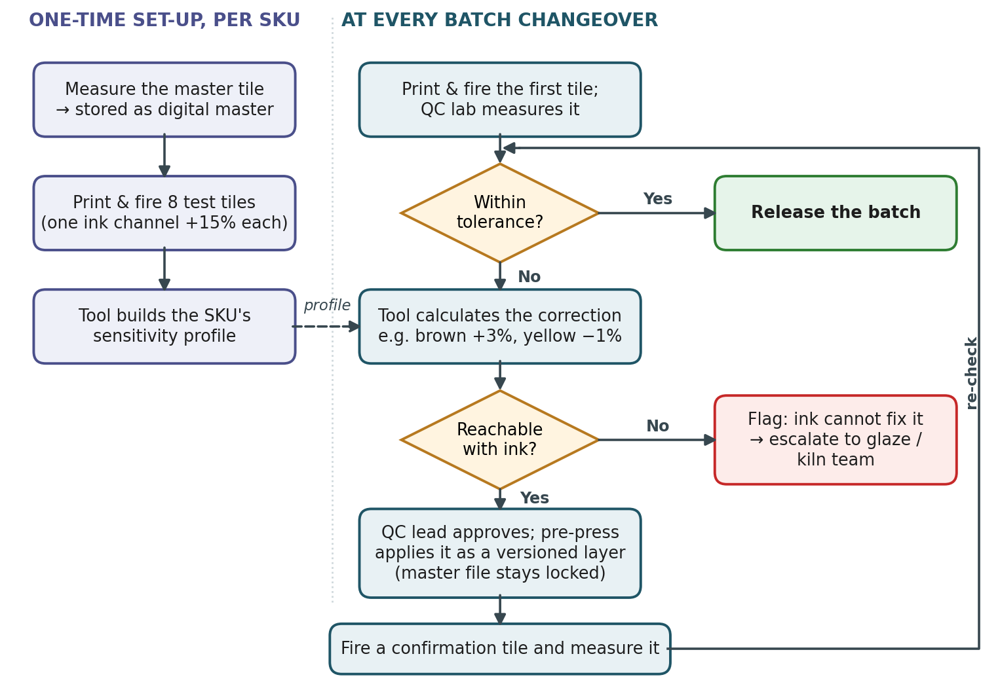
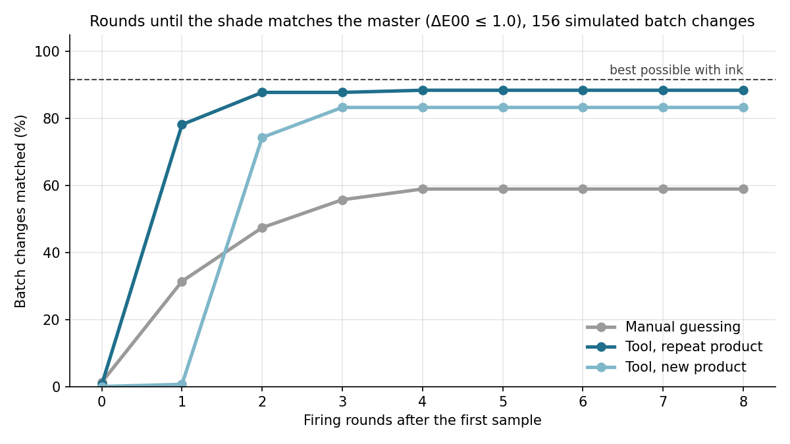

# Print Shade Correction at Batch Changeover

### Case Study and Pilot Proposal: Client A (Ceramic Tiles)

| | |
|---|---|
| **Prepared by** | Abhishek, Forward Deployed Engineer |
| **Prepared for** | Delivery Team Lead; for onward discussion with Client A's procurement, QC and pre-press teams |
| **Date** | 14 October 2026 |
| **Version** | 1.0, following the first discovery call |
| **Classification** | Confidential |

---

## 1. Executive Summary

Client A is one of the largest ceramic tile manufacturers by volume, with plants in the UAE,
India and Bangladesh. Each time an SKU is re-run, the fired shade drifts away from the approved
master tile, even when the same print file is used. The QC team then edits the print file in
Photoshop by eye, prints and fires six to seven variants, checks them in the lab and repeats.
One round takes six to seven hours. The line keeps running throughout, and the client estimates
5,000–10,000 m² of off-shade output per correction.

The client described this as a vision-analytics requirement. My assessment is that measurement
is not the gap: the lab already reports ΔL, Δa and Δb against the master with a
spectrophotometer. The gap is converting that measured difference into a specific correction to
the printer's input file. That is the problem this proposal addresses.

**Proposed solution.** A correction tool that sits between the QC lab and pre-press, in four steps:

1. **Digital master.** Each master tile is measured once and stored as a numeric reference.
2. **One-time characterisation per SKU.** Eight planned test tiles, each raising one ink channel by 15%, show how every channel moves the fired shade on that SKU.
3. **Correction at changeover.** The lab measures the first tile, the tool calculates the channel adjustment (e.g. brown +3%, yellow −1%), the QC lead approves it, pre-press applies it, and one confirmation tile is fired before the batch is released.
4. **Locked master file.** The approved print file is never overwritten; each correction is stored as a separate, versioned adjustment layer.

The tool also replaces visual acceptance with a single numeric tolerance, reports gloss next to
colour, and flags cases that ink cannot correct (a darker glaze, a large kiln shift) rather than
issuing a recommendation that will not work.

**Expected outcome.** A repeat SKU is corrected with two firings (first tile and one
confirmation) instead of one or more 6–7-hour rounds. In a simulation of 156 changeovers, the
method matched 78% of cases in a single round against 31% for a skilled manual operator, and
used about 2 test tiles per changeover instead of 27 (Appendix E).

**Commercials.** I recommend a 12-week, single-plant pilot at a fixed price of **₹52,00,000**
(excl. GST), invoiced in three milestones tied to results: first analysis in week 2, first live
correction in week 6, go/no-go in week 12. A week-8 checkpoint caps the client's exposure if the
method does not perform. Estimated net value is **₹44 lakh to ₹2.24 crore per line per year**;
across a four-line plant, the pilot pays back within 3.5 months.

## 2. Background and Client Context

Decoration is printed onto glazed tiles by a six-channel digital inkjet printer, then fired in a
kiln. Once the first sample of a batch is in shade, the rest of the batch stays in shade, so the
problem is concentrated at changeover.

### 2.1 Stated request versus underlying need

| Client's request | Underlying need, as I assess it |
|---|---|
| "Video / vision analytics" | Not a camera system. The existing spectrophotometer is more accurate than a camera under factory lighting. |
| Compare the master tile with the production tile | Already done in the lab (ΔL, Δa, Δb). |
| Tell the team what to change in the printer's input file | **The actual gap:** a calculated, per-channel correction in place of a visual estimate. |
| "Minutes, not hours" | The calculation takes minutes; one fired confirmation tile cannot be avoided. The realistic target is one correction instead of several rounds. |
| No need to run continuously on the line | Agreed; the tool is used at batch changeovers only. |
| Root cause of drift is out of scope for now | Agreed; the correction works regardless of what caused the drift. |

### 2.2 Current-state process

```
 Batch changeover for an SKU
          |
          v
 Printer loads the reference file   <-- often a repeatedly edited copy, not the approved original
          |
          v
 Print 1 tile -> fire -> lab check (spectrophotometer + visual)
          |
     In shade? -- yes --> release the batch
          | no
          v
 Estimate a fix in Photoshop ("brown +5%") -> 6-7 variants
 -> print -> fire -> lab check                    <-- 6-7 hours per round
          |
          +--> repeat until matched, or released at "99% close"

 The line keeps running throughout -> off-shade m2 accumulate
```

### 2.3 Stakeholder analysis

| Stakeholder | Primary interest | Implication for the proposal |
|---|---|---|
| **Special Projects Lead, Procurement** (main contact) | Evidence that it works, cost certainty, limited risk | Fixed price, milestone billing tied to results, week-8 checkpoint, first output in week 2 |
| **Head of IT & OT Procurement** | Hardware footprint, plant deployment, OEM partners, OT security | No new production hardware in the pilot; runs on a lab PC isolated from the OT network; an at-line station is a later option |
| **Plant QC / lab team** (daily users; not on the call) | Less rework, objective acceptance, no extra workload | Uses readings the lab already takes; QC approves every correction |
| **Design / pre-press team** (not on the call) | Control of the artwork | Corrections are channel-level adjustment layers; the artwork is never modified |
| **Plant / production manager** | Less off-shade output, protected line time | Test tiles run in planned sample slots |
| **Ink supplier and RIP vendor** (external) | Their tools and service role respected | The tool operates on top of RIP curves and ink profiles; it adds the SKU-level layer neither covers |

## 3. Problem Statement

1. **Trial-and-error correction.** Fixes are estimated visually, so each correction needs one or more 6–7-hour print-fire-measure rounds.
2. **Off-shade output during correction.** The line runs throughout the loop; the client estimates 5,000–10,000 m² of off-shade tiles per event.
3. **Subjective acceptance.** Operators judge shade by eye and choose different correction points, so results vary by person and shift.
4. **Reference-file drift.** Corrections are saved into the reference image, so today's file may differ materially from the version approved in 2021.
5. **No defined tolerance.** Batches at "99% match" are released without a numeric acceptance limit.

## 4. Open Questions and Working Assumptions

Ranked by their effect on the design and the business case. The full register (15 items) is in Appendix A.

| # | Question for the next call | Why it matters | Working assumption |
|---|---|---|---|
| 1 | **Print file and inks:** printer and RIP, file format, the six channels (any effect inks?), how "+5% brown" is applied today, and what the RIP and ink supplier already provide for colour. | The correction must be applied the way pre-press actually edits files; vendor capabilities may reduce scope. | Six colour channels, edited per channel in Photoshop; no effect ink among them; no SKU-level correction from vendors. |
| 2 | **Measurement practice:** instrument, measuring spots and faces on patterned tiles, ΔE formula, tolerance, data export. | Defines the tool's input and the acceptance criterion. | Exportable readings; 3–5 fixed spots per tile; tolerance ΔE00 ≤ 1.0 until the client confirms its own. |
| 3 | **Volumes and economics:** lines in the pilot plant, output per line (m²/h), corrections per line per month, rounds per correction, handling of off-shade stock, ex-factory price. | Drives the business case; the off-shade figure was unclear in the call recording. | 4 lines; 4 corrections per line per month; 1–2 rounds; 5,000 m² per event; ₹350/m²; 15–40% value loss on off-shade. |
| 4 | **Product portfolio and history:** active SKUs, groupings by ink set and glaze, repeat frequency, retained correction records. | Determines characterisation effort; records provide a ready baseline. | Several hundred SKUs; no usable records, so the baseline is measured during the pilot. |
| 5 | **Roles and site:** daily operator, approver, access to QC and pre-press, choice of pilot plant. | The daily users were not on the call; plant choice affects cost. | QC operates, QC lead approves, pre-press applies; UAE plant (the site the client invited us to). |

## 5. Options Analysis

| Option | Description | Assessment | Rationale |
|---|---|---|---|
| A. Inline camera system | Cameras inspect every tile on the line | Rejected | Only changeovers need control; camera colour is unreliable under factory lighting; high capex; inferior to the existing spectrophotometer. |
| B. Physics model of ink, glaze and kiln | Model chemistry and firing | Rejected | Requires process data that does not exist; long lead time; root cause is out of scope. |
| C. Machine-learning model on history | Learn corrections from past records | Deferred | No dataset exists today; becomes viable once the tool has logged enough runs. |
| D. Full colour chart per SKU | Large printed chart mapping the full colour space | Fallback | Accurate but needs many more test tiles; reserved for SKUs where the recommended method underperforms. |
| E. Vendor capability (RIP / ink supplier) | Use existing vendor colour tools or service | To be verified | Vendors calibrate printers and inks, not "this SKU against its master". Their tools are used underneath the recommended solution. |
| **F. Measure-and-correct tool** | Characterise each SKU once, then calculate corrections from lab readings | **Recommended** | Uses the existing instrument and routine; needs no historical data or new hardware; works whatever caused the drift. |

**Out of scope for the pilot:**

- Inline cameras or continuous monitoring.
- Root-cause analysis of kiln or raw-material variation (the data logged by the tool will support it later).
- Automatic changes to the printer; every correction is approved by a person.
- Gloss correction; gloss is measured and reported only.
- Any change to the artwork beyond channel-level adjustment.
- New production hardware.

## 6. Recommended Solution

### 6.1 Solution overview



| | Repeat SKU | New SKU |
|---|---|---|
| Firings per changeover | **2**: first tile + confirmation | **3**: first tile + 8-tile characterisation + confirmation |
| Time until the corrected file is on the line | ~3 hours | ~9.5 hours on first run; repeat runs then follow the 3-hour path |

**Approval and governance.** No correction reaches the printer without QC-lead approval, and no existing role is removed. Every approval, correction and result is logged against SKU, line and date.

**Built-in safeguards:**

- **Numeric acceptance.** One ΔE00 tolerance (or the client's own) replaces visual judgement.
- **Gloss reporting.** Gloss is recorded with every reading.
- **Out-of-reach detection.** Ink only adds colour; a darker glaze or a large kiln shift is reported as not correctable, with the likely source.
- **Stale-profile detection.** If a confirmation tile falls clearly short of the predicted result, the tool requests a fresh characterisation.

### 6.2 Rationale

- **No historical dataset required.** The eight test tiles generate the data, at roughly the lab effort of one of today's correction rounds.
- **No kiln model required.** The tool learns from fired results, so kiln effects are already included in what it measures.
- **No capital expenditure in the pilot.** It runs on the client's spectrophotometer, Photoshop workflow, printers and staff.
- **Removes reference-file drift permanently,** because corrections no longer overwrite the master.
- **Established method.** Sensitivity-based recipe correction is standard in textile dyeing and paint; it is validated here on a print-fire simulator (Appendix E).

### 6.3 Integration with existing tools, roles and routine

| | Current practice | With the tool |
|---|---|---|
| Measurement | Lab spectrophotometer | Same instrument, with a fixed measuring template so every reading is taken at the same spot and face |
| Correction | Visual estimate in Photoshop | Calculated per channel; approved by the QC lead |
| Applying the fix | Edits saved over the reference file | Supplied as a Photoshop Curves preset and applied as an adjustment layer; master stays locked |
| Changeover routine | First tile, then repeated variant rounds | First tile, one confirmation tile |

### 6.4 Data requirements

| Data | Owner | Frequency |
|---|---|---|
| Master tile readings (colour and gloss) | QC lab | Once per SKU |
| Approved master print file | Pre-press | Once per SKU |
| Characterisation readings (8 tiles) | QC lab | Once per SKU |
| First-tile and confirmation readings | QC lab | Every changeover (existing practice) |
| Correction applied, approver, outcome | Tool (automatic log) | Every changeover |
| Ink lot, glaze batch, kiln settings | Production records | Every changeover |

## 7. Implementation Plan

### 7.1 Phases, milestones and client dependencies

| Phase | Weeks | Activities | Client dependencies | Milestone / output |
|---|---|---|---|---|
| **0. Remote assessment** | 1–2 | Analyse the client's readings of master and variation tiles, a sample print file and any correction records; calculate differences and indicative corrections | Data exports, one print file, records | **Week 2:** difference report and indicative corrections on the client's own tiles (proven on the line only in week 6) |
| **1. Site set-up** | 3–4 | On-site engineer: QC and pre-press workshops, installation, digital masters for 5–8 SKUs, baseline measurement | Site access, QC and pre-press time, IT approval | Digital masters in place; baseline signed off |
| **2. Characterisation** | 5–6 | 8 test tiles per pilot SKU; first live correction | Sample slots on the line | **Week 6:** first live correction on the line |
| **3. Pilot operation** | 7–11 | Tool used at real changeovers across the plant's lines, plus planned test runs; weekly scorecard | Changeover schedule, lab readings | Weekly results; **checkpoint at week 8** |
| **4. Decision** | 12 | On-site results review | Decision meeting | **Go / no-go with measured results** |

### 7.2 Success criteria and evaluation protocol

| Element | Definition |
|---|---|
| **Baseline** | Retained correction records (rounds, hours, off-shade m²), verified against changeovers observed under the current method in weeks 3–6 |
| **Primary metric** | ΔE00 between the corrected tile and the digital master after one correction |
| **Acceptance threshold** | ≥ 80% of changeovers within tolerance (ΔE00 ≤ 1.0, or the client's own) after one correction |
| **Sample size** | ~20 changeovers across at least 5 SKUs in one plant: real changeovers plus planned test runs. New SKUs reported separately; 80% on ~20 runs is a go/no-go signal, not a precise rate |
| **Measured by** | The client's QC lab, on its own instrument; the delivery team never enters readings |
| **Stop criterion** | At week 8, after 10 changeovers: if fewer than half are within tolerance, the pilot stops and only milestones reached are invoiced |

### 7.3 Commercials and business case

| Item | Detail |
|---|---|
| **Pilot fee** (fixed, 12 weeks, one plant) | **₹52,00,000** (~$59,100), excl. GST. India-plant option: ₹47,00,000 (~$53,400), reflecting lower travel |
| **Milestone billing** | 20% at kickoff (₹10,40,000) · 40% at the first live correction within tolerance, ~week 6 (₹20,80,000) · 40% when the acceptance threshold is met, week 12 (₹20,80,000). If the week-8 stop criterion is met, only milestones reached are invoiced |
| **Delivery team** | Forward Deployed Engineer (1.0 FTE), colour/data engineer (0.75 FTE average), software engineer (0.5 FTE), engagement lead (0.25 FTE): **7.5 person-months** |
| **Client effort during the pilot** | ~75 staff-hours and ~72 sample tiles (≈ ₹81,000) |
| **Post-pilot running cost** | Subscription ₹1,25,000 per line per month (~$1,420) for software, updates and support; total client running cost ₹1,40,640 per line per month, against ₹25,600–46,800 today (lab time and sample tiles) |
| **Net value per line** | **₹44 lakh – ₹2.24 crore per year**, driven by reduced off-shade output rather than lab savings; the range reflects open Question 3 (calculations in Appendix C) |
| **Payback on the pilot fee** | Single line: 14 to 2.8 months. **Four-line plant: 3.5 to 0.7 months** |

### 7.4 Risk register

| Risk | Impact | Mitigation | Owner |
|---|---|---|---|
| The print file cannot be adjusted in the assumed way | High | Confirm in Question 1; fall back to RIP channel curves | FDE / pre-press |
| The line responds less predictably than modelled, so one correction is not enough | High | Weekly scorecard and week-8 stop criterion; fallback to a full colour chart (Option D) | FDE |
| Too few changeovers during the pilot window | Medium | Cover all lines in the plant, add planned test runs, extend by up to 3 weeks at the delivery team's cost | Engagement lead |
| Readings taken at a different spot or face from the master | High | Fixed measuring template, face labels on every tile, mismatched readings rejected | QC lab |
| Low adoption by QC and pre-press (absent from the first call) | Medium | Early workshops; QC retains approval; the tool removes guesswork and blame, not roles | FDE / plant manager |

## 8. Recommended Next Steps

1. A 45-minute follow-up call with the QC lead, pre-press lead and plant manager to close Questions 1–5.
2. The client shares spectrophotometer exports, one print file and any correction records (week 1).
3. Confirm the pilot plant, then issue the pilot agreement with milestones and the stop criterion as above.


---

# Appendices

## Appendix A. Question Register and Working Assumptions

| # | Question | Working assumption |
|---|---|---|
| 1 | Printer, RIP and file format; the six channels; effect inks (matt, gloss, lustre, white); how "+5%" is applied; total ink limit; vendor colour capabilities | Six colour channels edited per channel in Photoshop; no effect ink among them; no SKU-level correction from vendors |
| 2 | Spectrophotometer model and aperture; gloss meter; spots and faces; ΔE formula and tolerance; spectral export | Exportable readings; 3–5 spots per face; ΔE00 ≤ 1.0; separate gloss meter |
| 3 | Lines in the plant; output per line; corrections per line per month; rounds per correction; off-shade handling (downgrade or separate shade lot); ex-factory price | 4 lines; 4 per month; 1–2 rounds; 5,000 m² per event; ₹350/m²; 15–40% loss |
| 4 | Active SKUs; groupings by ink set and glaze; repeat frequency; correction records; whether the variation tiles come with the edits that produced them | Several hundred SKUs; no usable records; edits unknown |
| 5 | Daily operator and approver; access to QC and pre-press; pilot plant; permission for planned test runs | QC operates, QC lead approves, pre-press applies; UAE; test runs permitted |
| 6 | Is gloss part of acceptance today? Does it vary with print settings, or only with glaze and firing? | Glaze and firing only; measured and reported |
| 7 | Target reference: master tile or previous run's sample? | Master tile, always |
| 8 | Number of faces per SKU and how a tile's face is identified | Several faces; 2–3 named faces are labelled and measured |
| 9 | Frequency and logging of ink-lot, glaze-batch, kiln-setting and print-head changes | Logged; several times a month per line |
| 10 | Time from print to a measurable fired tile | ~1.5 hours |
| 11 | Availability of a lab sample printer, and whether it behaves like the production printer | Test tiles run on the production line in planned slots |
| 12 | Cloud or on-premises deployment | On-premises lab PC, isolated from the OT network |
| 13 | The process-flow document referred to on the call | Not received; to be requested |
| 14 | Printers and ink suppliers across the UAE, India and Bangladesh | Not required for the pilot; relevant for rollout |
| 15 | Can sample tiles be shipped from the Indian plant? | Yes, avoiding customs delays |

## Appendix B. Decision Log and Data Reliability Notes

**Decisions taken where the notes were unclear:**

| Decision | Reason |
|---|---|
| Target is the master tile, stored as a digital master | Matching the previous run is how drift accumulates |
| Off-shade volume of 5,000 m² per event | Low end of a "5,000–10,000 m²" figure marked unclear in the recording |
| Tolerance of ΔE00 ≤ 1.0 | Common industry level, pending the client's own value |
| "Six primary colours" read as six ink channels | Consistent with per-channel edits in Photoshop |
| Pilot across all lines of one plant, UAE by default | The client invited a site visit in the UAE; an India option is priced lower |
| Current practice modelled as 1–2 correction rounds | The notes give both "6–7 hours per round" and "6–7 hours to get a correction right" |
| Off-shade value loss modelled as 15–40% | Off-shade stock may be sold as a separate shade lot rather than downgraded |
| Gloss measured and reported, not corrected | Gloss is driven mainly by glaze and firing |

**Statements in the notes treated with caution:**

- "5,000–10,000 m²": marked unclear in the recording.
- "6–7 hours": per round, or for a full correction.
- "5–6 minutes": achievable for the calculation, not for a fired confirmation.
- "99% matching": no metric was named.
- "Same print file every time" (brief) vs. "the reference keeps being edited" (notes): the evidence points to a drifted file.
- "Video analytics": describes the client's framing, not the need.
- The process-flow document: referenced but not available.

## Appendix C. Commercial and Business-Case Calculations

All figures in Indian Rupees, excluding GST; USD at ~₹88 = $1.

**C.1 Milestone billing.** ₹52,00,000 × 20% = ₹10,40,000; × 40% = ₹20,80,000; × 40% = ₹20,80,000.
India option: ₹47,00,000 → ₹9,40,000 / ₹18,80,000 / ₹18,80,000.

**C.2 Off-shade output per changeover** = line output (m²/h) × hours until the corrected file is on the line.

| Scenario | Hours until corrected |
|---|---|
| Current, 1 round | first tile 1.5 h + 6.5 h = **8 h** (implies ~625 m²/h at 5,000 m²) |
| Current, 2 rounds | 1.5 + 2 × 6.5 = **14.5 h** (implies ~345 m²/h) |
| With the tool, repeat SKU | first tile 1.5 h + calculation + confirmation 1.5 h = **3 h** |
| With the tool, new SKU | 1.5 + characterisation 6.5 h + 1.5 = **9.5 h** |

Reduction = 1 − (hours with the tool ÷ current hours):

| | Current: 2 rounds (14.5 h) | Current: 1 round (8 h) |
|---|---|---|
| Repeat SKU | 1 − 3/14.5 = 79% | 1 − 3/8 = 62.5% |
| New SKU | 1 − 9.5/14.5 = 34% | 1 − 9.5/8 = −19% (slower on first run) |
| Mix: 80% repeat, 20% new | **≈ 70%** | **≈ 46%** |

**C.3 Value per line.**

| | Low case | High case |
|---|---|---|
| Current rounds per correction | 1 | 2 |
| Value loss on off-shade stock | 15% | 40% |
| Loss per changeover: 5,000 m² × ₹350 × loss | ₹2,62,500 | ₹7,00,000 |
| Per month (4 changeovers) | ₹10,50,000 | ₹28,00,000 |
| Reduction (C.2) | 46% | 70% |
| Gross saving per month | ₹4,83,000 | ₹19,60,000 |
| Additional running cost per month (C.4) | − ₹1,15,040 | − ₹93,840 |
| **Net saving per month** | **₹3,67,960** (~$4,200) | **₹18,66,160** (~$21,200) |
| **Net saving per year** | **₹44,15,520** | **₹2,23,93,920** |
| Payback, one line: ₹52,00,000 ÷ net monthly saving | ≈ 14 months | ≈ 2.8 months |
| Payback, four lines: ₹52,00,000 ÷ (4 × net monthly saving) | ≈ 3.5 months | ≈ 0.7 months |

Excluded from the figures: fewer customer complaints over mismatched re-orders, and consistency across plants.

**C.4 Client running cost** (₹600 per staff-hour; ₹500 per sample tile).

| Per changeover | Tiles | Staff-hours | Cost |
|---|---|---|---|
| Current, 1 round | 8 | 4 | ₹6,400 |
| Current, 2 rounds | 15 | 7 | ₹11,700 |
| Tool, repeat SKU | 2 | 2 | ₹2,200 |
| Tool, new SKU | 10 | 5 | ₹8,000 |
| Tool, 80/20 mix | | | ₹3,360 |

| Per line per month | Current (1 round) | Current (2 rounds) | With the tool |
|---|---|---|---|
| Lab and pre-press (4 changeovers) | ₹25,600 | ₹46,800 | ₹13,440 |
| Allowance for additional tiles (2 × ₹500 + 2 staff-hours) | – | – | ₹2,200 |
| Subscription | – | – | ₹1,25,000 |
| **Total** | **₹25,600** | **₹46,800** | **₹1,40,640** |

**C.5 Client effort during the pilot.** Sample tiles: 40 characterisation + 20 for planned test
runs + ~12 allowance = 72 × ₹500 = ₹36,000. Staff time: 75 hours × ₹600 = ₹45,000. **Total ≈ ₹81,000.**

## Appendix D. Technical Specification

**D.1 Correction model.** Each channel is scaled by a percentage of the ink already present
(×1.03 = "+3%"). Unprinted areas stay unprinted, so the design is preserved; a flat offset would
deposit ink where the design has none and is therefore not used. If light and dark areas prove
to drift differently, the model moves to a two-parameter curve per channel. Corrections are
issued as Photoshop Curves presets applied as adjustment layers over the locked master, or as
RIP channel curves.

**D.2 Calculation.** The characterisation set (the master file printed twice, then each channel
at +15%) gives the change in L, a and b per channel at each measuring spot. The tool solves for
the smallest set of channel changes that cancels the measured difference (constrained least
squares: ±15% per step, 70–130% overall) and updates the profile after each confirmation tile.

**D.3 Safeguards.**

- *Out of reach:* if no allowed change can bring the tile within tolerance, the tool reports it. This verdict is issued only once the profile has been confirmed against the current line state, which prevents false alarms.
- *Stale profile:* if a confirmation tile fails and falls clearly short of the predicted result, the tool requests a new characterisation.

**D.4 Physical limits.**

- Ink only adds colour. A darker or yellower glaze or body cannot be lightened in light or unprinted areas.
- A large kiln change can shift hue; ink adjustments compensate only partly.
- Gloss is governed mainly by glaze and firing, not by the print file.

**D.5 Measurement repeatability.** A fixed template locates each tile so readings are taken at
the same positions; every tile carries a face label; and the print file's channel values are
averaged over the instrument's measuring aperture.

**D.6 Reliability of the master tile.** Fired glaze is chemically stable and does not fade
meaningfully in storage, although it can become soiled or chipped. The drift the client
describes sits in the reference file. Once stored numerically, the master cannot fade or be lost.

**D.7 Future enhancements:**

- *Line calibration tile:* one standard tile per line after an ink, glaze or kiln change, to pre-compute corrections before changeover.
- *SKU families:* shared profiles for SKUs with the same ink set and glaze, to reduce characterisation effort.
- *Full spectral data:* storing the complete reflectance curve rather than three values.
- *K/S colour model:* the more linear model used in textile colour matching.
- *Direct ΔE00 optimisation:* weighting the calculation by the acceptance formula itself.
- *Similar-ink detection:* identifying channels that move colour in the same direction (e.g. brown and beige).
- *Planned test runs:* deliberate, blind file offsets that the tool must correct, as an ongoing control.
- *At-line measurement station:* automatic readings at the kiln exit, sourced with an instrument manufacturer.
- *RIP integration:* sending approved corrections directly to the printer software, still subject to approval.
- *Company-wide shade standard and master library:* one numeric master per SKU across all three plants.
- *Drift dashboard:* lines, ink lots and glaze batches ranked by drift, as a low-cost starting point for root-cause work.

## Appendix E. Prototype Validation (Synthetic Data)

**Set-up.** A non-linear simulator stands in for the printer, glaze and kiln: ink absorption,
dot gain, kiln-driven strength and hue shift, and glaze colour drift. The correction tool has no
access to its internals and receives only noisy lab readings. The manual baseline represents a
skilled operator who knows the direction in which each ink moves the shade, chooses the best
ink each round, and prints six variants. Random seeds were fixed before any run. Notebook:
`prototype/shade_correction.ipynb`.



| 156 changeovers requiring correction | Matched in 1 round | Within 2 rounds | Not matched | Tiles per changeover |
|---|---|---|---|---|
| Manual correction | 31% | 47% | 41% | 26.7 |
| Tool, repeat SKU | **78%** | **88%** | 12% | **2.1** |
| Tool, new SKU (round 1 = characterisation) | 1% | 74% | 17% | 9.9 |
| Best achievable with any ink change | 92% | 92% | 8% | – |

- Of the changeovers that could be corrected, the tool resolved **85% in one round against 34%** for manual correction.
- It flagged **all 13** changeovers that no ink change could correct, with 5 false alarms out of 143.

**Failure case 1: darker glaze.** First-tile ΔE00 of 3.4–4.7 per spot. After one confirmation
tile, the tool reported that the master could not be reached with ink changes (best achievable
≈ 2.5) and pointed to the glaze or body; 2 tiles were used. Manual correction ran 8 rounds and
49 tiles without a match.

**Failure case 2: stale profile after a large kiln change.** The first correction delivered
less than predicted (ΔE00 2.6 against 2.0 predicted), so the tool flagged its profile as stale,
re-characterised with 8 tiles, then reported the case as not correctable (best achievable ≈ 2.3)
and pointed to the kiln; 10 tiles were used. Manual correction ran 8 rounds and 49 tiles without a match.

**Observations and limits.** Stored profiles remained valid under normal ink, glaze and kiln
variation; the stale-profile check triggered only under an extreme kiln change. The simulation
validates the method, not the client's specific printer, glaze and kiln. Only the pilot can
establish that.

## Appendix F. Glossary

| Term | Definition |
|---|---|
| **Spectrophotometer** | Laboratory instrument that measures colour precisely, independent of ambient lighting |
| **Lab (L\*, a\*, b\*)** | Three values describing a colour: L = lightness, a = red–green, b = yellow–blue |
| **ΔL, Δa, Δb** | Difference from the master in lightness, red–green and yellow–blue |
| **ΔE00 (CIEDE2000)** | Single number expressing perceived colour difference; about 1.0 is a just-noticeable difference |
| **Tolerance** | The largest ΔE00 accepted as a match |
| **Gloss** | Surface shine, measured separately from colour |
| **Master tile** | The approved tile for an SKU; the target every batch must match |
| **Digital master** | The master tile's measured values, stored numerically |
| **SKU** | One specific tile design and finish |
| **Face** | One of several pattern variations printed for the same SKU |
| **Print / reference file** | The image sent to the digital printer, with one channel per ink |
| **RIP** | Raster image processor: the printer software that converts the image file into ink drops |
| **Characterisation** | The one-time set of 8 test tiles that teaches the tool how an SKU responds |
| **Kiln / firing** | The furnace that hardens the printed tile; firing can shift colour |
| **Glaze / body** | The surface coating and the clay base on which the decoration is printed |
| **Changeover** | The start of a new production batch of an SKU |
| **Off-shade** | Output that does not match the master shade |
| **Shade lot** | Tiles sorted and sold under a common shade code |
